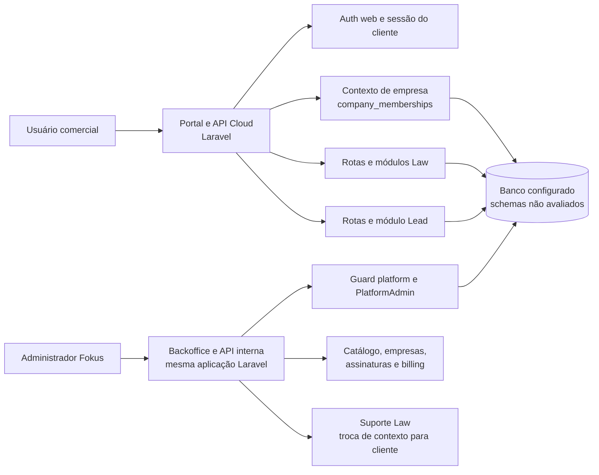
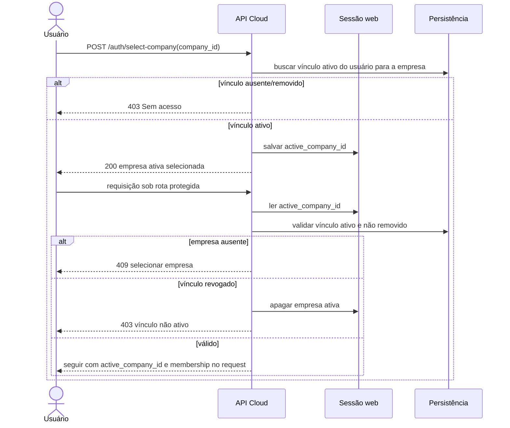

# Observação estática de arquitetura — Fokus Cloud e Admin

**Revisão do código:** `jorgewreis/fokus-cloud`, `main` em `5a34b4dcf0caf256126b4495f43c981bf3cc609d` (2026-11-23). **Tipo de evidência:** inspeção estática de rotas, middleware, serviços, controllers e nomes de testes; nenhuma aplicação foi executada e nenhum ambiente servido foi consultado. Este documento não declara prontidão, segurança aprovada ou implantação.

## Contexto e containers observados

O checkout contém uma aplicação Laravel/PHP, frontend e assets no mesmo repositório. O Admin/Backoffice aparece como área e conjunto de rotas da aplicação Cloud (`/api/backoffice`), não como repositório ou artefato independente comprovado. As rotas também incluem fluxos Law e Lead. Isso descreve o código do SHA inspecionado; não aprova o acoplamento como arquitetura final nem prova publicação/runtime.

O diagrama representa relações identificadas nas rotas e fontes abaixo. Ele não afirma que a configuração de produção usa um único banco, que haja isolamento efetivo entre produtos, nem que o estado operacional corresponda ao commit.

## Componentes e contratos observados

| Componente | Evidência no SHA | Contrato estático aparente | Limites a verificar |
| --- | --- | --- | --- |
| Autenticação de cliente | `routes/api.php`; `AuthController`; guard `web` | Login/logout, sessão autenticada, escolha explícita de empresa e endpoints para aceitar convite/vínculo. Algumas rotas públicas têm throttling; rotas protegidas ficam sob `auth`. | Cenários completos de convites, conta suspensa, rotação/revogação de sessão e resposta uniforme a enumeração exigem execução e revisão por fluxo. |
| Contexto de empresa | `EnsureCompanyContext`; `company_memberships` | O middleware lê `active_company_id` da sessão e confirma vínculo ativo/não removido para usuário e empresa antes de preencher atributos da requisição. Se o vínculo não existir, limpa a empresa ativa e retorna 403; sem empresa ativa, retorna 409. | Revisar toda rota sensível para confirmar que usa o middleware e que consultas/filas mantêm o mesmo escopo. Cobrir mudança concorrente de permissão e sessão aberta. |
| Administração do espaço | `CompanyUserController`; prefixo `/api/portal` | Rotas para atualizar/restaurar membros e modificar/restaurar acesso Law, dentro de `auth` e `EnsureCompanyContext`. | Confirmar regras por papel, produto, ação e transferência de administração; identificar se remoção invalida todas as sessões/credenciais no Law direto. |
| Backoffice Fokus | `PlatformAdmin`, `PlatformAuthController`, `EnsurePlatformAdmin`, `EnsurePlatformPermission`; prefixo `/api/backoffice` | Usa guard `platform` e entidade `PlatformAdmin`, login com senha e etapa MFA, permissões internas específicas por rota e área separada da identidade do cliente no código. | A distinção de guards no código não prova isolamento de armazenamento, cookies, sessões, operadores, dados ou deploy; validar configuração, migrations e fluxo completo. |
| Sessões internas | `PlatformSessionAuthority`; `PlatformSessionAuthorityTest` | A autoridade durável vincula a sessão interna aos guard(s) e invalida mutações se autoridade revogada/inválida; há testes nomeados para essas condições. | Testes não foram executados nesta revisão; durabilidade/atomicidade no banco alvo e comportamento sob falhas de runtime continuam sem comprovação aqui. |
| Suporte | `PlatformSupportController`, `EnsureSupportSession`, `SupportSessionSecurity`; endpoints exclusivos de superadmin | Inicia suporte para assinatura Law não encerrada com empresa, vínculo e usuário ativos, motivo obrigatório e auditoria; autentica guard `web` como usuário-alvo, define empresa ativa e redireciona a `/portal`. A validação aceita assinatura suspensa; exige que ela não esteja encerrada. Duração configurável, saída encerra sessão e registra evento. | **Divergência com a decisão de produto:** a decisão vigente limita suporte a dados comerciais/técnicos e exclui conteúdo operacional do escritório. O fluxo estático concede contexto de usuário no Law. Exigir gate de desenho/autorização e evidência de que operadores não podem consultar ou alterar conteúdo antes de aceitar esse fluxo. |
| Catálogo, empresa e assinatura | `BackofficeController`; `routes/api.php` | Permissões `platform.*` protegem rotas de catálogo, empresas, assinatura, pagamentos, auditoria e vouchers. Alguns endpoints de idempotência ou mutação incluem middlewares de rejeição explícita. | Revisar cada permissão HTTP e efeito transacional. Existência do middleware de bloqueio também pode significar fluxo ainda indisponível; não assumir que CRUD está utilizável. |

## Fluxo: seleção e validação de empresa

Sequência observada em `AuthController::selectCompany` e `EnsureCompanyContext`; é uma leitura da implementação do commit, não uma prova de comportamento sob execução.

## Divergência de suporte e decisão necessária

A decisão registrada no Plano Diretor diz que suporte no piloto vê dados comerciais e técnicos, sem conteúdo operacional do escritório; eventual exceção pós-piloto exigiria autorização específica, prazo e auditoria. No código do SHA observado, as rotas de suporte Law exigem superadmin, mas `start()` autentica a sessão web como o usuário-alvo, seleciona a empresa e leva ao `/portal`. `routes/web.php` registra `routes/api.php` dentro do grupo `web`; `bootstrap/app.php` inclui `EnsureSupportSession` nesse grupo. O middleware encerra a sessão interna se expirar, se o admin perder disponibilidade/permissão de acesso ou se a identidade `web` não coincidir com o alvo. O fluxo também registra motivo, duração configurável e auditoria. Essas proteções controlam identidade, validade e trilha da sessão, mas não demonstram restrição de leitura/escrita do conteúdo operacional.

**Critério para aceite do Cloud/Admin:** demonstrar, por teste negativo de autorização em servidor e revisão das rotas alcançáveis, que suporte não lê nem altera processos, contatos ou demais dados operacionais; ou registrar uma decisão de produto que aprove exceção com escopo, consentimento/autoridade, duração e auditoria compatíveis. Até lá, o suporte Law estático é um risco e o critério permanece pendente. Esta revisão não desabilita nem altera o endpoint.

## Mapa de verificação para o próximo ciclo

| Critério observável | Evidência requerida | Estado nesta revisão |
| --- | --- | --- |
| Guard de cliente não aceita identidade interna, e guard interno não aceita sessão de cliente. | Testes negativos executados, cookies/sessões distintos e revisão de configuração. | Casos nomeados em `PlatformSecurityTest`; execução/configuração não verificadas. |
| Seleção e revogação de espaço bloqueiam acesso a outro tenant. | Testes de API com dois espaços, vínculo revogado e sessão já aberta; prova de ausência de dados na resposta. | Checagem de vínculo observada no código; matriz integral de testes não executada. |
| Permissões são concedidas por produto e ação. | Matriz role→product→action e testes negativos para cliente, admin de espaço, admin interno e superadmin. | Rotas mostram permissões internas e `law.permission`; mapa completo ainda pendente. |
| Convite é distinto de vínculo/permissão e tem estados seguros. | Cenários de preview/aceitação, expiração, replay, destinatário errado, revogação e auditoria. | Endpoints e lógica de aceitação presentes; matriz e execução pendentes. |
| Suporte não acessa conteúdo operacional no piloto. | Teste negativo abrangente sobre rotas Law, sessão de cliente e endpoints API/web; ou decisão formal de exceção. | Não satisfeito pela inspeção estática; divergência documentada acima. |
| Frontend e API comunicam loading, vazio, erro, expiração e perda de acesso. | Testes de navegação ponta a ponta e inspeção visual em viewport representativo. | Há testes de browser por diretório; nenhum executado nesta revisão. |

Em `PlatformSecurityTest::test_superadmin_support_access_uses_real_member_and_is_audited_until_exit`, a cobertura estática confirma que o cenário de teste permite o superadmin entrar no modo de suporte, obtém `/api/auth/me` com `support_mode.active`, omite telefone, bloqueia uma alteração de perfil, registra início/fim, encerra acesso e aplica expiração de 30 minutos. `test_only_superadmin_can_list_law_subscriptions_for_support` cobre a negação ao administrador comercial para o contexto de suporte. `LeadDatabaseTest::test_support_and_cross_company_context_are_blocked` recusa uma sessão de suporte ao acessar o banco do Lead. Esses testes não tentam listar, abrir, criar, editar ou apagar processos/contatos Law durante a sessão, nem demonstram isolamento equivalente no Law. A cobertura atual sustenta guard, auditoria, expiração e restrições específicas de perfil/Lead, mas **não** o critério de ausência de acesso operacional Law.

Outros testes existentes localizados por nome incluem `AuthenticationAndIsolationTest`, `CompanyAdminTest`, `PlatformSessionAuthorityTest` e `BackofficeSecurityTest`, além de testes browser de backoffice. A existência dos testes não comprova que estejam verdes ou cubram todos os critérios acima; nenhum foi executado nesta revisão.

## Relação com as decisões e backlog

- REI-191 cobre arquitetura e reconciliação do repositório central.
- REI-193 cobre inventário de dependências e discrepâncias de fontes.
- REI-166 trata extração do domínio Law comercial do repositório Cloud; é diferente de manter o Law on demand da 1ª Vara fora do repositório central.
- A separação Cloud/Admin em releases e banco independentes ainda precisa de decisão arquitetural; a implementação observada coloca ambos na mesma aplicação.
- A próxima issue de aceite deve relacionar identidade, espaço, convite e suporte ao comportamento verificado, sem duplicar REI-165 (enumeração) ou tarefas de segurança internas já existentes.

## Referências de código

- [`routes/api.php`](https://github.com/jorgewreis/fokus-cloud/blob/5a34b4dcf0caf256126b4495f43c981bf3cc609d/routes/api.php), rotas de autenticação, cliente, portal e backoffice.
- [`AuthController.php`](https://github.com/jorgewreis/fokus-cloud/blob/5a34b4dcf0caf256126b4495f43c981bf3cc609d/app/Http/Controllers/Api/AuthController.php), login, seleção de empresa e aceitação de vínculo.
- [`EnsureCompanyContext.php`](https://github.com/jorgewreis/fokus-cloud/blob/5a34b4dcf0caf256126b4495f43c981bf3cc609d/app/Http/Middleware/EnsureCompanyContext.php), validação de tenant no middleware.
- [`EnsurePlatformAdmin.php`](https://github.com/jorgewreis/fokus-cloud/blob/5a34b4dcf0caf256126b4495f43c981bf3cc609d/app/Http/Middleware/EnsurePlatformAdmin.php) e [`EnsurePlatformPermission.php`](https://github.com/jorgewreis/fokus-cloud/blob/5a34b4dcf0caf256126b4495f43c981bf3cc609d/app/Http/Middleware/EnsurePlatformPermission.php), guarda e autorização do backoffice.
- [`PlatformSupportController.php`](https://github.com/jorgewreis/fokus-cloud/blob/5a34b4dcf0caf256126b4495f43c981bf3cc609d/app/Http/Controllers/Api/PlatformSupportController.php), início e encerramento de suporte.
- [`PlatformSecurityTest.php`](https://github.com/jorgewreis/fokus-cloud/blob/5a34b4dcf0caf256126b4495f43c981bf3cc609d/tests/Feature/PlatformSecurityTest.php), testes de segurança e suporte existentes.
