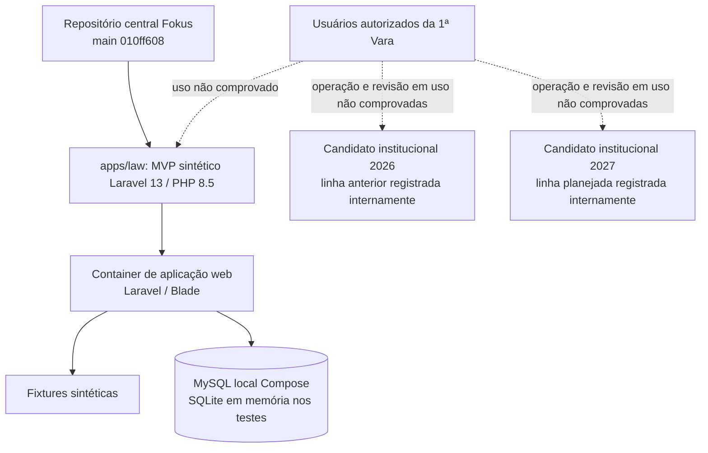

# Reconciliação do Law on demand e sua fronteira de repositório

**Data da verificação:** 23/11/2026 (America/Bahia)  
**Estado:** evidência documental e de código; destino canônico e revisão em uso ainda não confirmados.  
**Decisão vigente:** o Law on demand da 1ª Vara Crime fica fora do repositório central Fokus e mantém aplicação, dados, identidade, autorização, ambiente e operação próprios.

## Objetivo e limite

Este registro compara `apps/law/` no repositório central com as linhas institucionais encontradas no inventário privado. Ele identifica proveniência técnica e incompatibilidades aparentes para orientar uma separação futura. Não escolhe o repositório que atende usuários, não designa destino, não autoriza uso de dados reais e não executa movimentação.

## Evidências observadas

| Fonte | Evidência | O que permite concluir | O que não comprova |
| --- | --- | --- | --- |
| [Fokus central, `main` em `010ff608`](https://github.com/jorgewreis/fokus/tree/010ff6087c355c2cd6abdf86733636717d91291f) | Contém `apps/law/`; o README dessa árvore descreve Laravel 13, PHP 8.5, fixtures sintéticas e um MVP institucional Pessoa → Processo. A configuração documenta Compose para desenvolvimento local e banco sintético, com testes SQLite em memória. | Há uma aplicação Laravel dedicada ao MVP sintético no repositório central. Seu histórico começa no commit [Bootstrap Laravel 13](https://github.com/jorgewreis/fokus/commit/f7603d2), anterior ao snapshot de `main`. | Não prova que ela seja o sistema que atende a Vara, que tenha sido publicada ou que use dados reais. A documentação proíbe inferir homologação/produção. |
| Candidato institucional de 2026, registrado somente nas fontes privadas | O inventário privado documenta uma linha institucional anterior com módulos operacionais. Os nomes do repositório e sua revisão não são reproduzidos nesta página pública. | Trata-se de uma linha diferente do MVP sintético descrito em `apps/law/`; não há evidência de compatibilidade de código. | Não prova estado atual, repositório canônico, versão servida, correspondência de commits nem destino adequado para o código Laravel. |
| Candidato institucional de 2027, registrado somente nas fontes privadas | O inventário privado registra uma linha de sucessão planejada, com transição condicionada a validação, backup e retorno. Identificadores e detalhes ficam nas fontes internas. | O plano não foi demonstrado como destino compatível nem como versão em uso do MVP Laravel atual. | Não prova runtime, cronograma vigente, relação com a implantação atual ou autorização para transferência. |

O checkout local consultado estava em `316ee9a`, ancestral do snapshot `010ff608` e 39 commits atrás de `origin/main`. O inventário usa o snapshot remoto citado, não trata o estado do checkout local como a revisão atual do servidor nem incorpora as alterações locais preexistentes.

## Mapa de contexto, containers e componentes

O mapa representa artefatos documentais e componentes declarados, não implantação. O banco local/SQLite de teste é parte do fluxo sintético documentado; nenhum banco institucional ou produção foi consultado. As setas tracejadas indicam perguntas sem evidência, não integrações. Nenhuma relação de histórico entre os três repositórios foi demonstrada; o repositório que atende usuários não está identificado.

## Conclusão técnica

1. `apps/law/` é uma aplicação Laravel sintética que nasceu no histórico do repositório central; não é demonstrada como cópia do sistema PHP/SQL legado nem da linha PHP/MySQL planejada.
2. O nome “Fokus Law” é usado em mais de um contexto. Para esta decisão, `Law Advocacia` é o produto comercial e `Law on demand` é a aplicação institucional personalizada da 1ª Vara.
3. As duas linhas institucionais conhecidas não podem ser escolhidas como destino apenas por compartilharem domínio ou instituição. Uma transferência direta de diretório confundiria stacks e não preservaria necessariamente histórico, publicação, dados ou dependências.
4. A fonte canônica que atende usuários e a compatibilidade/destino para o código Laravel permanecem desconhecidos. Não remover, renomear, copiar ou mover `apps/law/` até que essa origem e um destino sejam confirmados com o responsável, e que o ensaio isolado de transferência e reversão passe.

## Roteiro reversível para a próxima etapa

1. Obter confirmação do responsável institucional sobre qual revisão/reposição atende usuários atualmente e qual repositório deve receber o MVP Laravel separado.
2. Inventariar referências locais e remotas: dependências, workflows, paths de build/deploy, documentos, issue links, artefatos e dados. Distinguir configuração declarada de uso comprovado.
3. Em cópia descartável, ensaiar extração com histórico preservado (por exemplo, filtragem do prefixo `apps/law/`), comparar árvore e ancestrais, executar CI e testes com fixtures, e documentar retorno para a origem. Não usar o checkout compartilhado para reescrever histórico.
4. Revisar separadamente acesso a identidade, banco, secrets e runtime; manter credenciais e ambientes sem compartilhamento com Law comercial.
5. Só depois de aceite verificável do destino, proveniência, CI e rollback, preparar uma alteração revisável no repositório central que remova a árvore sem destruir seu histórico. A promoção do novo repositório permanece sujeita a autorização própria.

## Gate de aceite desta reconciliação

- [x] A decisão de exclusão do Law on demand do repositório central foi registrada, sem reinterpretar histórico anterior.
- [x] `apps/law/` foi identificado por stack, finalidade sintética e origem de histórico.
- [x] Os candidatos institucionais foram comparados sem os declarar canônicos nem expor seus identificadores privados nesta página pública.
- [x] O diagrama separa repositórios e marca os fluxos não verificados.
- [ ] Responsável confirma o repositório/revisão que atende usuários e o destino do MVP Laravel.
- [ ] Ensaio isolado de transferência, histórico, CI e reversão é aprovado.
- [ ] Separação física revisável é implementada somente após os gates anteriores.

Este documento atende somente à etapa de reconciliação documental parcial; não fecha REI-193 nem libera a remoção física de `apps/law/`.
