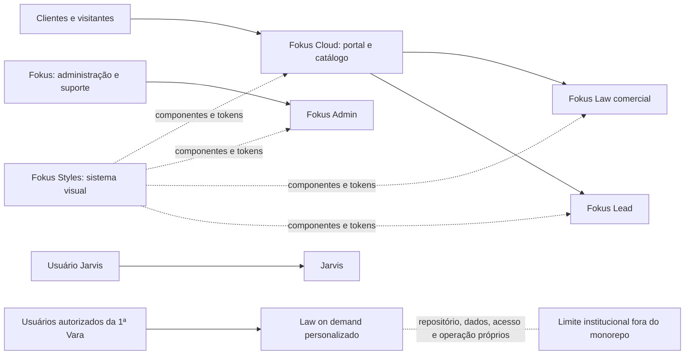

# Arquitetura conceitual do portfólio Fokus

**Estado:** mapa de produto e limites pretendidos; não representa arquitetura implantada nem seleciona stack para produtos ainda não inventariados.

## Contexto

O diagrama registra os produtos e a separação pretendida. Os contratos concretos, dependências de identidade e comunicação entre Cloud, Admin e produtos comerciais serão definidos e validados em ADRs; não se presume compartilhamento direto de banco.

## Limites arquiteturais a definir

- **Cloud:** portal comercial, catálogo e área de clientes.
- **Admin:** administração da plataforma Fokus, com privilégios e dados separados dos administradores de espaço do cliente.
- **Law e Lead:** domínios comerciais independentes; autorização, dados e fluxos devem ser verificados por produto e espaço.
- **Styles:** tokens, componentes e documentação visual compartilhados; catálogo privado separado da distribuição pública.
- **Jarvis:** fronteira própria de execução e autonomia, integrada apenas por contratos autorizados.
- **Law on demand:** sistema fora do monorepo central, sem contas, banco, produção ou autorização compartilhados.

## Visões a produzir após o inventário

1. C4 de contexto com atores e sistemas externos confirmados.
2. C4 de containers por aplicação, runtime, persistência e infraestrutura confirmados.
3. Componentes e sequências para login/vínculo, convites, autorização, revogação e integração de produto.
4. UML de domínio, estados ou implantação somente quando necessário para resolver ambiguidade verificável.

## Estrutura de código proposta para avaliação

Agrupar aplicações em `apps/`, bibliotecas justificadas em `packages/` e documentação corporativa em `docs/`. Confirmar nomenclatura e compatibilidade com o conteúdo atual antes de criar ou mover árvores. Cada app deve declarar proprietário, dependências, contratos, comandos de desenvolvimento/CI e processo de release. Bibliotecas compartilhadas precisam de consumidor identificado, versão, testes e política de compatibilidade.

Essa estrutura é uma proposta para ADR, não descrição do estado atual nem autorização para movimentar `apps/law/`.

## Contratos e fluxos

- Documentar dono do dado, identificador, classificação, finalidade, retenção e autorização em cada fluxo entre produtos.
- Versionar contratos API/webservice; especificar identidade, escopos, erro, idempotência, limite, timeout, retry e compatibilidade onde aplicável.
- Usar gateway, filas e processamento distribuído somente após confirmar requisitos de operação e registrar decisão; não usar o gateway como proprietário das regras de domínio.
- Nenhum produto pode depender de acesso não documentado às tabelas internas de outro produto.

## Limitações

Este documento não confirma tecnologias, topologia de produção, disponibilidade, volumes, orçamento, integrações nem estado dos repositórios remotos. As decisões dependem do inventário e de ADRs vinculados a evidências.
