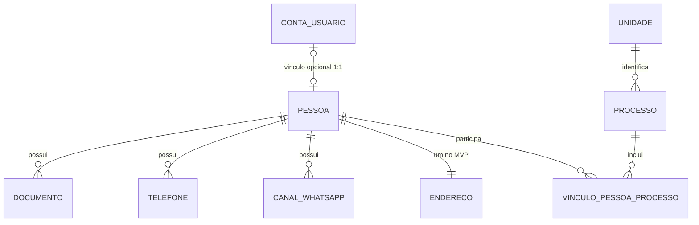

# Dicionário de domínio — Pessoas e Processos

**Estado:** modelo conceitual do MVP; não descreve schema implementado.
**Atualizado em:** 20/11/2026
**Produto:** Fokus Cloud Law — 1ª Vara Crime de Ilhéus.
**Fontes canônicas:** [PRD do MVP no Notion](https://app.notion.com/p/41b6af4c510981e0b980eff10759823a), seções 2–4; [REI-206 — Funcionalidades e regras dos módulos](https://app.notion.com/p/41c6af4c510981fe9a7ee9268c630bfe); [REI-220 — esta documentação](https://linear.app/reis-developer/issue/REI-220/vara-documentar-dicionario-de-dominio-de-pessoas-e-processos). Quando houver divergência, prevalece a decisão explícita mais recente registrada no PRD.

Este documento descreve conceitos, relações e invariantes aprovados. Os nomes em português são vocabulário conceitual. Não define o schema físico. O trabalho em andamento na branch da REI-196 acrescentou modelos e migrations de Pessoa/Processo e rotas parciais; esse código ainda precisa passar por revisão, CI e merge antes de ser tratado como parte integrada do produto.

## 1. Escopo e convenções

- **MVP:** cadastro e consulta autorizados de Pessoas e Processos sintéticos, e navegação entre eles por vínculos tipados, sujeitos a módulo, unidade e sigilo.
- **Fora do MVP:** Gestão de Expedições, Tarefas e Audiências; não modelar esses itens como requisito atual nem conservar a Expedição no percurso obrigatório. Múltiplos endereços e lotação/vínculo com unidades governamentais também são futuros.
- **Fonte e estado:** cada regra abaixo é identificada como aprovada, futura ou pendente. Pendências não autorizam defaults ou regras inferidas.
- **Identificadores:** Pessoa, Processo e Unidade têm identificadores internos estáveis e gerados pelo sistema, conceitualmente independentes de documentos e do CNJ. O tipo físico do identificador fica para a etapa de schema.

## 2. Entidades e relações

O diagrama é conceitual e omite dimensões de autorização. Não representa tabelas existentes.

### 2.1 Pessoa

Cadastro de uma pessoa física ou jurídica. O nome é obrigatório; o identificador interno é gerado automaticamente. A classificação PF/PJ é imutável após a criação. Não há fluxo de correção aprovado e o sistema não deve mudar a classificação nem ocultar ou excluir documentos automaticamente em resposta a uma alteração.

| Conceito/campo | Regra do MVP | Estado e fonte |
|---|---|---|
| Identificador interno | Gerado automaticamente, estável e independente de documento pessoal. | Aprovado; PRD §4.3. Tipo físico pendente para schema. |
| Classificação | Pessoa Física ou Pessoa Jurídica; fixa após criação. | Aprovado; decisão do PRD de 19/11/2026. Não há fluxo de correção aprovado. |
| Nome | Obrigatório. Busca de Pessoas somente por nome. | Aprovado; REI-206, cadastro de Pessoas. |
| Documentos | Zero ou vários tipos permitidos, somente tipos aplicáveis à classificação; no máximo um número por tipo e todos opcionais. Catálogo abaixo. | Aprovado; PRD §4.3. |
| Endereço | Exatamente um no MVP. | Aprovado; PRD §4.3. |
| Telefones | Zero ou vários, sem limite de quantidade; cada telefone tem categoria Celular/Fixo. Se houver telefone, exatamente um é principal. | Aprovado; decisão do PRD de 19/11/2026 e regras de contato. |
| Canais WhatsApp | Zero ou vários, sem limite de quantidade; no máximo um principal. Não habilitam envio de mensagens. | Aprovado; decisão do PRD de 19/11/2026. |

**Deduplicação de nome:** comparar ignorando maiúsculas/minúsculas e espaços no início/fim ou repetidos, preservando acentos e pontuação. Preservar o nome original. Exibir aviso apenas para Pessoas que o usuário já pode consultar, sem identificar o registro; exigir confirmação explícita para prosseguir e registrar a confirmação. A regra vem da seção 5.1 do PRD.

#### Documento

Conceito subordinado a Pessoa, com tipo e valor informado. Tipos aprovados: RG, CPF, CNPJ, Inscrição Estadual, Passaporte, CNH, Título de Eleitor, PIS, CAD, MAT e CIN. Todos são opcionais e cada Pessoa pode ter no máximo um número de cada tipo. Aplicabilidade: CPF, RG, Passaporte, CNH, Título de Eleitor, PIS, CIN e MAT para PF; CNPJ e Inscrição Estadual para PJ; CAD para PF ou PJ. Exibir apenas tipos aplicáveis. Órgão emissor e UF são opcionais quando aplicáveis; validade documental fica fora do MVP. CPF/CNPJ, quando informados, recebem validação local de formato e dígitos verificadores. Para os demais tipos, usar validador local determinístico previamente definido; sem regra aprovada, validar somente caracteres e tamanho permitidos. Não consultar serviços externos nem rejeitar por regras não definidas.

Preservar o valor informado para exibição e armazenamento. Comparação de duplicidade pode normalizar somente por tipo documental, usando regra aprovada para aquele tipo; não aplicar transformação genérica. Quando houver correspondência, exibir alerta genérico, sem revelar a identidade ou dados da outra Pessoa; permitir prosseguir após confirmação auditada. Não copiar o número para auditoria ou logs. A matriz por tipo está em [normalizacao-documentos.md](normalizacao-documentos.md): nenhum tipo tem transformação de comparação aprovada nesta etapa, portanto comparações documentais permanecem desabilitadas até decisão específica; cadastro e deduplicação de nome podem avançar.

#### Telefone

Conceito de contato vinculado a Pessoa: número brasileiro com DDD válido, categoria obrigatória `Celular` ou `Fixo`, e indicação de principal. Quando existir um ou mais telefones, um e somente um deve ser principal. O PRD requer armazenamento normalizado e exibição em formato brasileiro, além da UF correspondente ao DDD. Por decisão de Jorge em 20/11/2026, para o DDD 61 exibir `DF/GO`, sem inferir município ou uma única UF, pois a tabela oficial da Anatel associa esse código a ambas as unidades. A tabela completa de CNs por UF é publicada pela [Anatel](https://www.anatel.gov.br/Portal/verificaDocumentos/documento.asp?assuntoPublicacao=null&caminhoRel=null&documentoPath=telefonia_fixa%2Fstfc%2Fcod_prestadoras%2Flista_csp_codigos_nacionais.pdf&filtro=1&numeroPublicacao=141766). A representação canônica física fica para o schema. Telefones são independentes dos identificadores WhatsApp, embora um canal WhatsApp telefônico possa referenciar um Telefone cadastrado.

#### CanalWhatsApp

Identificador de WhatsApp ligado a Pessoa. O tipo é telefone ou nome de usuário; a chave de usuário é opcional e pertence ao canal, não é credencial do Fokus. Pode haver vários identificadores; se houver algum, exatamente um é principal. Quando o identificador for telefone, pode referenciar um Telefone da Pessoa ou conter número independente sujeito às regras brasileiras de DDD, normalização e exibição. Se coincidir após normalização com telefone da mesma Pessoa, reutiliza-se o telefone existente conceitualmente, sem duplicá-lo. Não há integração ou envio de mensagens no MVP.

#### Endereço

Objeto de valor único da Pessoa no MVP. CEP, logradouro, número, cidade e UF são obrigatórios; complemento e bairro são opcionais. Consulta pública individual envia somente o CEP; após sucesso, os campos retornados ficam bloqueados. Em falha ou ausência de resultado, permitir preenchimento manual e registrar a ocorrência. O PRD restringe ViaCEP a consultas individuais iniciadas pelo usuário no MVP sintético, sem consultas em lote; antes de qualquer uso institucional ou com dados reais, seus termos e garantias devem ser reavaliados. Múltiplos endereços são futuros.

### 2.2 ContaUsuario e vínculo com Pessoa

Conta e cadastro de Pessoa são conceitos separados. A associação é opcional e tem cardinalidade máxima 1:1: uma conta pode se vincular a no máximo uma Pessoa, e uma Pessoa a no máximo uma conta. Pessoas sem conta e contas sem Pessoa são válidas; credenciais, autenticação e permissões não integram o cadastro pessoal. No ambiente sintético, somente Jorge estabelece ou altera o vínculo e a ação é auditável. Igualdade de e-mail não comprova identidade e não cria vínculo automaticamente.

Decisão de auditoria de 20/11/2026: o evento de vínculo registra ator, instante, operação, IDs internos da Conta e da Pessoa e resultado. A autoedição de contato registra ator, instante, ação, ID interno da Pessoa e resultado. Não registrar valores de endereço/telefone nem e-mail na trilha.

Exceção aprovada do PRD: uma conta ativa vinculada pode alterar somente telefone e endereço do próprio cadastro, com auditoria. A rota própria identifica a Pessoa pela conta autenticada; não permite alterar nome, documentos, WhatsApp, classificação PF/PJ ou vínculo. No formulário atual, telefone associado a identificador WhatsApp não pode ser trocado/removido nessa operação limitada; a regra preserva a referência até revisão do produto.

A exclusão de Pessoa vinculada a conta fica bloqueada. Não desvincular, excluir ou suspender a conta em cascata. O ciclo explícito de desvinculação/suspensão permanece pendente na [REI-234](https://linear.app/reis-developer/issue/REI-234/vara-definir-ciclo-de-desvinculacao-de-conta-e-pessoa). A regra aprovada de exclusão também impede excluir Pessoa com qualquer vínculo Pessoa–Processo.

### 2.3 Unidade

Entidade conceitual com identificador interno estável. A configuração do módulo Gestão de Processos aponta para a Unidade ativa no ambiente MVP; novos Processos recebem automaticamente essa referência. Sem Unidade configurada, bloquear cadastro de Processo. Cada Processo preserva a Unidade à qual foi associado: mudar a configuração não transfere registros existentes. No MVP sintético, somente Jorge pode alterar a configuração, com auditoria. Não se presume suporte a outras unidades ativas.

### 2.4 Processo

Registro local identificado internamente, associado a uma Unidade, com CNJ obrigatório e classificação processual. O CNJ deve ter formato e dígito verificador válidos, ser normalizado conforme regra aprovada e persistido como identificador processual; componentes codificados são calculados sob demanda. A correção do CNJ mantém o identificador interno, verifica unicidade por Unidade e é auditada com usuário, data/hora e valores anterior/novo. Não criar duplicidade por Unidade. Se outro registro acessível já existir, reutilizar; não confirmar nem revelar existência de registro fora do escopo de acesso.

A criação pode ocorrer sem classe e assuntos. Se a classe estiver ausente, o usuário deve escolher explicitamente uma competência ativa configurada para a Vara; não inferir competência do CNJ. Com classe, aplicar o mapa classe–competência vigente: selecionar automaticamente quando houver uma única associação ativa e exigir escolha quando houver várias. A regra vigente na REI-206 exige, em qualquer edição do Processo, exatamente uma classe e pelo menos um assunto; pode haver vários assuntos. Classe e assuntos pertencem a catálogos controlados pela administração e sincronizados mensalmente pela API pública SGT/CNJ. A sincronização é de catálogo, não importa Processos. Se falhar ou a resposta for inválida, manter o último catálogo válido, exibir a data da última sincronização bem-sucedida e preservar classificações existentes. Valor desativado não pode ser escolhido em novo registro, mas continua associado ao registro existente e no histórico. Sem carga válida inicial, desabilitar somente a escolha de classe/assuntos, ainda permitindo criar Processo por CNJ e competência explicitamente escolhida.

Estados operacionais aprovados: `Ativo` (padrão), `Suspenso`, `Arquivado Provisoriamente` e `Arquivado Definitivamente`. Qualquer estado pode mudar diretamente para qualquer outro; quem tem permissão efetiva de edição pode inclusive reabrir o Processo definitivamente arquivado. Não se exige motivo; registrar a transição em auditoria. Arquivados não aparecem na lista padrão, mas podem ser localizados por filtro. Não há exclusão de Processo no MVP. Filtros aprovados: CNJ, estado operacional, classe e assuntos.

### 2.5 Vínculo Pessoa–Processo

Entidade associativa explícita entre Pessoa e Processo, pois ambos podem participar de várias relações. Cada par Pessoa–Processo tem um único vínculo, com exatamente um tipo obrigatório: `Réu`, `Vítima`, `Testemunha` ou `Defensor`. Para `Testemunha`, registrar no próprio vínculo a origem `Denúncia`, `Defesa` ou ambas; não criar relações duplicadas para representar as duas origens. Tipos adicionais não estão aprovados. Ao criar ou reutilizar Processo a partir do contexto de uma Pessoa, registrar seu vínculo e exigir o tipo.

### 2.6 Dimensões de autorização

Módulo/ação, Unidade, competência e sigilo são dimensões distintas. A Unidade é associada explicitamente ao Processo; competência e sigilo não são inferidos do CNJ, da Unidade ou do tipo de participação. O acesso fora do escopo deve ser negado sem revelar a existência de Processo não autorizado.

- **Sigilo:** atributo/dimensão separado. Por decisão de Jorge em 20/11/2026, o vocabulário de referência do MVP sintético é o do [Decreto Judiciário TJBA nº 218/2025, texto compilado](https://www7.tjba.jus.br/secao/arquivo/9/39235/DJ%20218.2025%20-%20Texto%20compilado.pdf): Público; Sigilo nível 1 (Segredo de Justiça); nível 2 (Mínimo); nível 3 (Médio); nível 4 (Intenso); nível 5 (Absoluto e Restrito ao Magistrado). A norma rege processos no PJe de 1º e 2º graus do TJBA; no Fokus sintético, esta adoção define somente vocabulário, sem importar automaticamente ACLs, autoridades ou equivalência institucional do PJe. O texto compilado chama nível 2 de “Mínimo”, mas uma alínea também o chama de “Médio”; preservar o código e registrar a inconsistência. **Atribuição sintética:** somente Jorge pode definir ou alterar explicitamente a classificação de um Processo sintético; cada ação deve ser auditada. Processo sem classificação nega acesso e não deve revelar sua existência a quem não está autorizado. **Correspondência conta–Processo (decisão de Jorge em 20/11/2026):** a conta precisa ter grant explícito do mesmo código de sigilo do Processo; não existe herança, comparação por maior/menor nível ou liberação por qualquer outro grant de sigilo. Divergência ou ausência de grant nega acesso. Unidade, módulo/ação e competência continuam verificações separadas e também obrigatórias. O acesso funcional está parcialmente integrado na branch da REI-196: há rotas de criação, consulta protegida, transição de situação e classificação administrativa com auditoria. Ainda faltam listagem filtrada, edição completa do Processo, correção de CNJ e validação integral dos critérios da [REI-196](https://linear.app/reis-developer/issue/REI-196/vara-aplicar-autorizacao-por-modulo-sigilo-e-autoria). A [REI-231](https://linear.app/reis-developer/issue/REI-231/vara-definir-catalogo-de-sigilo-e-acesso-a-processos-sinteticos) registra a decisão e seus exemplos de autorização.
- **Competência:** dimensão separada de Unidade e sigilo. A referência é a aba `Competencias juízo` da [planilha oficial de tabelas auxiliares MPM](https://www.cnj.jus.br/wp-content/uploads/2025/04/tabelas-auxiliares-mpm.xlsx); a [extração versionada](catalogos/README.md) tem 39 códigos e descrições e registra origem e hash. Jorge revisará e aprovará cada atualização antes de aplicá-la no ambiente sintético; códigos retirados serão preservados em Processos e grants históricos, sem alteração silenciosa de acesso. O fluxo de atualização do catálogo MPM ainda não foi implementado. No ambiente sintético, Jorge configura com auditoria ramo, grau, uma ou várias competências da Vara e o mapa explícito entre competências e classes do SGT. As classes disponíveis respeitam ramo, grau, situação ativa e mapa; elegibilidade incerta permanece bloqueada até prova oficial e revisão por Jorge. A extração oficial SGT versão 05/11/2026 mostrou que listagem por ramo/grau, isoladamente, inclui classes inativas; por isso a seleção precisa verificar detalhes individuais (situação e flags do grau/ramo), e ainda não foi habilitada. Uma classe pode corresponder a várias competências, caso em que o usuário escolhe uma. Uma única correspondência pode ser atribuída automaticamente. Alterar a classe exige revalidar a competência e escolher uma válida se necessário. A conta deve possuir grant explícito da mesma competência do Processo, concedido por Jorge; ausência ou divergência nega acesso. Competência retirada da configuração permanece nos Processos existentes e não pode ser usada em novos cadastros; o acesso continua exigindo o grant correspondente. Ao mudar a classe desses Processos, exige-se competência ativa compatível. Por decisão de Jorge, o código MPM `999` (Não se aplica) não é selecionável nem concedido no ambiente sintético; o serviço interno atual o recusa para grant. Os [PRs #24](https://github.com/jorgewreis/fokus/pull/24), [#25](https://github.com/jorgewreis/fokus/pull/25) e [#27](https://github.com/jorgewreis/fokus/pull/27) adicionaram base de grants, configuração/snapshot e serviço auditado de mapa. Elegibilidade completa do catálogo, interface de revisão, integração ao Processo, autorização funcional e MySQL/InnoDB ainda estão em andamento na [REI-196](https://linear.app/reis-developer/issue/REI-196/vara-aplicar-autorizacao-por-modulo-sigilo-e-autoria). Para evidências e limitações da fonte oficial atual, ver [referência SGT](referencia-sgt-classes.md).
- **Auditoria de negações:** registrar no catálogo somente eventos expressamente aprovados. Auditoria geral de tentativas negadas de leitura ou alteração segue pendente; não ampliar coleta por inferência.

Os resultados verificáveis e exemplos da regra de acesso a Processos estão na [matriz de autorização sintética](matriz-autorizacao-sintetica.md). A matriz é um contrato documental; não atesta implementação dos controles.

Quando uma competência é retirada da configuração, desativar também, na mesma transação e sob o lock/revisão da configuração, os vínculos classe–competência existentes que a utilizam. Preservar as linhas históricas e os Processos já classificados; a combinação deixa de estar disponível para novos cadastros. Se a competência voltar à configuração da Vara, os vínculos antigos continuam inativos até Jorge revisá-los e reativá-los explicitamente, com auditoria. Se a classe de um Processo existente for alterada, exigir combinação classe–competência ativa antes de concluir. A infraestrutura interna do mapa foi integrada pelo PR #27; a branch da REI-196 agora usa a regra na criação (classe opcional e competência explícita quando ausente), mas não implementa a edição completa nem os catálogos SGT/assuntos.

## 3. Itens futuros e decisões pendentes

### Fora do MVP

- Gestão de Expedições, Tarefas e Audiências.
- Múltiplos endereços e lotação/vínculo com unidades governamentais.
- Fluxo de correção de classificação PF/PJ.
- Integração/envio de mensagens WhatsApp.
- Dados reais, uso institucional ou integrações de Processos além das consultas/catalogação explicitamente previstas.

### Pendências que afetam implementação

| Tema | Limite atual | Rastreabilidade |
|---|---|---|
| Catálogo de sigilo e autorização de Processo | Jorge classifica/altera com auditoria; exigir grant explícito do mesmo código; ausência/divergência nega. Acesso funcional aguarda implementação dos gates necessários. | [REI-231](https://linear.app/reis-developer/issue/REI-231/vara-definir-catalogo-de-sigilo-e-acesso-a-processos-sinteticos) |
| Catálogo/atribuição de competência | Snapshot MPM versionado; configuração e mapa explícito por Jorge; grant da mesma competência. Implementar fluxo de aprovação de atualização MPM, revisão SGT, integração ao Processo e autorização completa. | [REI-196](https://linear.app/reis-developer/issue/REI-196/vara-aplicar-autorizacao-por-modulo-sigilo-e-autoria) |
| Normalização/duplicidade documental | Preservar original; comparação por tipo aguarda regra aprovada. | [REI-233](https://linear.app/reis-developer/issue/REI-233/vara-definir-normalizacao-e-duplicidade-dos-documentos-de-pessoas) |
| Desvincular/suspender Conta–Pessoa | Bloqueia exclusão de Pessoa vinculada a conta; sem cascata. | [REI-234](https://linear.app/reis-developer/issue/REI-234/vara-definir-ciclo-de-desvinculacao-de-conta-e-pessoa) |
| Representação física de IDs e telefones | Definir somente na proposta de schema, consultando padrões Laravel existentes. | Etapa posterior de schema. |
| Reconciliação do backlog Expedições | Resolver conflito de critérios antes de migrations ou telas. | [REI-217](https://linear.app/reis-developer/issue/REI-217/vara-reconciliar-issues-de-implementacao-com-o-escopo-vigente-do-mvp) |

## 4. Verificação e limitações

- Conferido contra o PRD vigente (última atualização indicada: 19/11/2026), REI-206 e escopo/critérios da REI-220 em 19/11/2026.
- Conferido o estado local do scaffold: não há modelos ou tabelas de negócio de Pessoa, Processo, Unidade ou vínculos. Esta verificação não prova implementação futura nem homologa comportamento.
- O texto registra decisões conceituais; não é proposta final de schema e não substitui a resolução das issues pendentes.
- Antes de liberar fluxos de Processo, reconciliar os critérios aplicáveis da REI-217 e implementar e validar os controles de acesso. A normalização documental bloqueia apenas comparação de duplicidade; REI-234 bloqueia o ciclo de exclusão/desvinculação correspondente.
