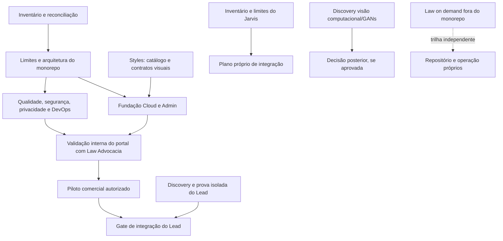

# Roteiro de implementação do portfólio Fokus

**Estado:** plano por gates, sem datas prometidas. Atualizar estado e evidências no Linear.

## Dependências

## Fase 0 — Reconciliação do portfólio

- Validar revisões e fontes canônicas, ambientes, publicação, dependências, dados e responsáveis de Cloud, Admin, Law comercial, Lead, Styles e Jarvis.
- Reutilizar as issues de inventário existentes (REI-191, REI-193, REI-189, REI-190 e REI-214) e a reconciliação de governança (REI-272); atualizar seus documentos relacionados sem apagar o histórico.
- Identificar o repositório canônico do Law on demand e registrar um plano reversível de separação. A decisão de excluí-lo do monorepo central está confirmada; sua migração física permanece bloqueada por confirmação de destino e dependências.
- Gate: matriz com cada ativo classificado como decisão, especificação, código presente, versão publicada comprovada ou desconhecida; origem, evidência, lacuna e responsável por resolver.

## Fase 1 — Arquitetura e governança

- Aprovar limites de contexto, fontes de verdade, estrutura de diretórios, contratos entre apps, política de bibliotecas compartilhadas, propriedade de dados e versionamento.
- Especificar identidade, empresas/espaços, acesso por produto, suporte, auditoria e revogação sem misturar clientes comerciais e operação institucional.
- Gate: ADRs revisados; fronteiras e fluxos de dados compreensíveis; dependências e riscos explicitados; aplicações com releases e rollback independentes.

## Fase 2 — Cloud, Admin, Styles e Law Advocacia

- Validar catálogo público, login, convites, espaços, troca de espaço, assinatura/backoffice e acesso ao Law Advocacia conforme decisões do Plano Diretor.
- Preservar o login Law existente no piloto; comprovar vínculo sem equiparar e-mail e sem copiar contatos ou processos.
- Aplicar Styles aos novos produtos comerciais; validar componentes, navegação por teclado, estados de tela, responsividade e consistência visual.
- Gate: aceite interno baseado em evidência revisada; depois, piloto com participantes e escopo aprovados; sem expansão se ocorrer falha crítica de isolamento, permissão, revogação ou perda de acesso.

## Fase 3 — Lead

- Discovery e prova sintética podem avançar em paralelo, preservando as especificações e o inventário existentes.
- Validar registro e acompanhamento individual de lead antes da integração. Gestão de equipe não faz parte desse critério de integração.
- Gate: aceite do piloto Law Advocacia e demonstração reproduzível do fluxo individual do Lead; integração ao portal continua bloqueada até ambos serem demonstrados.

## Fase 4 — Jarvis

- Inventariar repositório, artefatos visuais, agentes, dados, permissões, interface, modelo/runtime e critérios de autonomia já aprovados.
- Definir plano para incorporar arquivos ao monorepo central preservando histórico e autonomia operacional. Não integrar modelo, ferramenta ou acesso a dados sem contrato e autorização.
- Gate: fonte oficial, builds, limites de dados e controles de autonomia identificados; protótipos visuais avaliados separadamente de funcionalidades operacionais.

## Fase transversal — Qualidade, segurança, UX e operação

- Acompanhar todos os produtos com rastreabilidade requisito → issue → teste/inspeção → evidência → aceite.
- Planejar testes unitários, integração, contrato, ponta a ponta, autorização, regressão e recuperação segundo risco e stack verificados.
- Criar manuais de aceitação por perfil e jornada; cobrir estados vazio, carregando, erro, sucesso, responsividade e acessibilidade.
- Avaliar LGPD/GDPR, NBR/ISO, Docker, Kubernetes, gateway, webservices e processamento distribuído conforme critérios nos documentos relacionados; manter decisão pendente quando faltar evidência.
- Gate de release: critérios obrigatórios atendidos; falhas residuais, exceções, reversão e aprovações registradas.

## Trilha exploratória

- Visão computacional e GANs ficam em discovery e protótipos isolados. O Gate de pesquisa exige caso de uso, dados autorizados, direitos, avaliação de qualidade/vieses, custo, segurança e critério de decisão antes de propor produção.
- Administração, marketing, vendas e ADS começam por pesquisa e hipóteses. Nenhuma data de campanha, preço, orçamento ou promessa comercial é criada por este roteiro.
